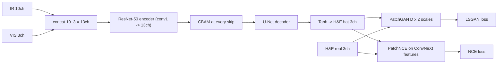
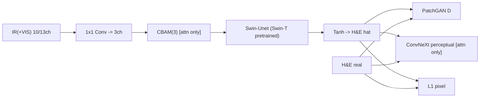
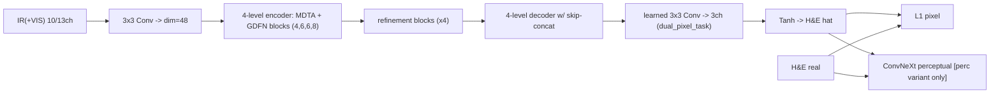
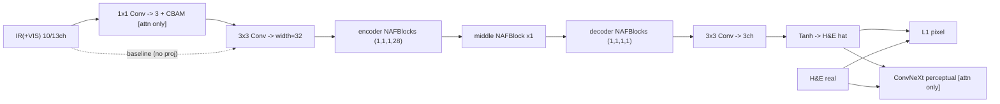
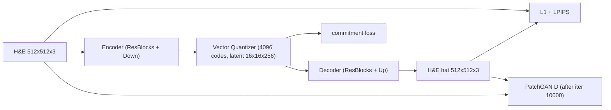
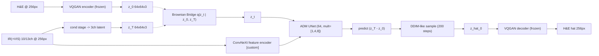
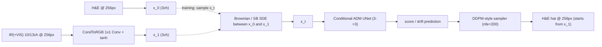

# VSlite: Virtual Staining Repository

VSlite is a specialized repository designed for translating multi-channel Infrared (IR) and optionally Visual (VIS) imaging modalities into synthetic H&E stains. The repository houses three distinct model architectures representing different generations and approaches to the virtual staining task:

1. **SwinGAN (Attention / Baseline)**
2. **Restormer (Transformers)**
3. **Contrastive Pix2Pix (Baseline)**

## Directory Structure

The repository is modularized based on architecture, dependencies, and functionality. All inactive, deprecated, or experimental profiling files have been moved to `legacy/`.


| Directory / File                       | Purpose                                                                                                                                                                                                           |
| -------------------------------------- | ----------------------------------------------------------------------------------------------------------------------------------------------------------------------------------------------------------------- |
| `**SwinGAN/`**                         | Contains the full implementation of the SwinGAN architecture (Generator, Discriminator, configs, and training/testing loops: `train_i2i.py`, `test_i2i.py`, `loss_i2i.py`).                                       |
| `**Restormer/**`                       | Contains the full PyTorch implementation of the Restormer architecture (`train_i2i_restormer.py`, `config_i2i_restormer.yaml`, `demo.py`).                                                                        |
| `**NAFNet/**`                          | Contains the NAFNet i2i implementation (`train_i2i_nafnet.py`, `test_i2i_nafnet.py`, `config_i2i_nafnet_*.yaml`).                                                                                                 |
| `**models/**`                          | Contains the PyTorch network definitions for the older `contrastive_pix2pix` and standard `pix2pix` models.                                                                                                       |
| `**trainers/**`                        | Houses the training loops (`contrastive_pix2pix_trainer.py`) specifically for the Pix2Pix models.                                                                                                                 |
| `**data/**`                            | Dataset classes (`VS_dataset.py`, `base_dataset.py`) and augmentations for the Pix2Pix dataloaders.                                                                                                               |
| `**dataset/**`                         | Local directory hosting the actual `.npy` data arrays and subsets (e.g., `data_frozen/`).                                                                                                                         |
| `**evaluation/**`                      | Contains calculation scripts for standard Image Translation metrics (`fid`, `psnr_ssim`, `group_evaluator`).                                                                                                      |
| `**options/**`                         | `argparse` configuration classes (`train_options.py`, `test_options.py`) for the Pix2Pix baseline.                                                                                                                |
| `**util/**`                            | Miscellaneous logging, HTML visualizers, and tensor transformation utilities.                                                                                                                                     |
| `**jobs/**`                            | Repo-local job scripts (some workflows also use authoritative Slurm scripts under `/u/akshahi2/jobs/...`).                                                                                                        |
| `**tests/**`                           | The automated Pytest suite validating dataset integrity, CLI configurations, and architecture block functionality.                                                                                                |
| `**tcga_tl_checkpoints/**`             | Houses the locally downloaded, finetuned ConvNeXt weights used dynamically as a Perceptual Feature Extractor by SwinGAN and Restormer.                                                                            |
| `**legacy/**`                          | **DEPRECATED**. Archived profiling scripts, old `final_code` clones, jupyter notebooks, and unused experiments (`DRB.py`, `memory_optimized` scripts). Files here are entirely disconnected from active training. |
| `scripts/train.py`                     | Training execution entrypoint for the **Pix2Pix** baseline.                                                                                                                                                       |
| `scripts/test.py`                      | Inference execution entrypoint for the **Pix2Pix** baseline.                                                                                                                                                      |
| `scripts/train_vqgan.py`            | Train VQGAN autoencoder on H&E targets (used by diffusion stacks).                                                                                                                                                |
| `environment.yml` / `requirements.txt` | Python package dependency declarations.                                                                                                                                                                           |
| `pytest.ini`                           | Pytest environment configuration settings.                                                                                                                                                                        |


## Slurm job scripts (authoritative)

For cluster runs, the authoritative job scripts live under:

- **Home**: `/u/akshahi2/jobs/<family>/<variant>/<train|test>/*.sh`

These scripts call the repo entrypoints (below) and set environment variables (GPU ID, dataroot, output dir, and eval caps).

## Dataset layout + deterministic splitting (train/val/test)

All model families are intended to use the same dataset root:

- `dataset/data_frozen/ir/*.npy`
- `dataset/data_frozen/vis/*.npy` (optional; only needed for 13ch IR+VIS)
- `dataset/data_frozen/he/*.npy`

Deterministic split is defined by **sample IDs / prefixes**:

- `dataset/data_frozen/test.txt` (authoritative held-out split; includes former val samples `10442`, `3840`)
- `dataset/data_frozen/val.txt` (present but empty — classic CISLNet does not use a true val split)

### Who reads `val.txt` / `test.txt`?


| Model family                                | How split is applied                                                                                     | Uses `val.txt` / `test.txt`? |
| ------------------------------------------- | -------------------------------------------------------------------------------------------------------- | ---------------------------- |
| **Baseline (contrastive_pix2pix)**          | `data/VS_dataset.py` uses `opt.phase in {train,val,test}` and filters by `val.txt`/`test.txt` if present | **Yes**                      |
| **VQGAN / diffusion datasets**              | `diffusion_vs/data.py` wraps `VS_dataset` and sets `opt.phase = split`                                   | **Yes**                      |
| **Restormer / SwinGAN / NAFNet (i2i YAML)** | `SwinGAN/utils/dataset_vslite_i2i.py` auto-detects `val.txt`/`test.txt` when `split` is enabled in YAML  | **Yes**                      |


### Important: enabling split for YAML-based i2i trainers

For Restormer/SwinGAN/NAFNet i2i trainers, splitting is enabled by setting a truthy `split` in the YAML config (e.g. `split: "train"`). Current configs are set to enable splitting:

- `Restormer/config_i2i_restormer.yaml`, `Restormer/config_i2i_restormer_perceptual.yaml`
- `SwinGAN/config_i2i_baseline.yaml`, `SwinGAN/config_i2i_attention.yaml`
- `NAFNet/config_i2i_nafnet_base.yaml`, `NAFNet/config_i2i_nafnet_attention.yaml`

## Centralized eval caps (consistent defaults across trainers)

Eval caps are centralized in `util/eval_caps.py` and can be overridden via environment variables.


| Cap type    | Env var(s)                                | Used by                                   | Default         |
| ----------- | ----------------------------------------- | ----------------------------------------- | --------------- |
| **Items**   | `UNIFIED_EVAL_MAX_ITEMS_TRAIN/VAL/TEST`   | Restormer / SwinGAN / NAFNet i2i trainers | 512 / 512 / 512 |
| **Batches** | `UNIFIED_EVAL_MAX_BATCHES_TRAIN/VAL/TEST` | Baseline + VQGAN training                 | 20 / 50 / 50    |


If you want *full* evaluation, set caps to `0` (where supported) or to a very large number; otherwise, these caps limit epoch-end evaluation overhead.

## Train entrypoints (what jobs call)

Each architecture uses its own isolated scripts mapped via YAML configurations (or `argparse` for Pix2Pix).

### SwinGAN (YAML)

```bash
python SwinGAN/train_i2i.py --config SwinGAN/config_i2i_attention.yaml
```

### Restormer (YAML)

```bash
python Restormer/train_i2i_restormer.py --config Restormer/config_i2i_restormer_perceptual.yaml
```

### NAFNet (YAML)

```bash
python NAFNet/train_i2i_nafnet.py --config NAFNet/config_i2i_nafnet_base.yaml
```

### Pix2Pix Baseline (argparse)

```bash
python scripts/train.py --input_nc 10 --num_ir_channels 10 --name vs10
python scripts/train.py --input_nc 13 --num_ir_channels 10 --name vs13
```

### VQGAN (argparse, resumable)

```bash
python scripts/train_vqgan.py --name vq_b --dataroot dataset/data_frozen --image_size 512 --amp --resume auto
```

## Train job “head-to-head” (default parameters)

These reflect the defaults when using the **training job scripts** in `/u/akshahi2/jobs/...` together with the repo configs.


| Model                 | Train job script                                              | Input mode         | Patch size used in training       | Batch size                         | Grad accum                               | Effective batch | AMP               | Perceptual / feature loss                                               |
| --------------------- | ------------------------------------------------------------- | ------------------ | --------------------------------- | ---------------------------------- | ---------------------------------------- | --------------- | ----------------- | ----------------------------------------------------------------------- |
| **Baseline**          | `/u/akshahi2/jobs/baseline/train/baseline_13.sh`              | `irvis13`          | `load_size=1024`, `crop_size=512` | 10                                 | 1                                        | 10              | (no explicit AMP) | ConvNeXt “VGG” is **off by default** unless `--no_vgg_loss false`       |
| **SwinGAN baseline**  | `/u/akshahi2/jobs/swingan/baseline/train/swingan_base_13.sh`  | `irvis13`          | `img_size=512`                    | 32                                 | 1                                        | 32              | (FP32)            | none                                                                    |
| **SwinGAN attention** | `/u/akshahi2/jobs/swingan/attention/train/swingan_attn_13.sh` | `irvis13`          | `img_size=512`                    | 32                                 | 1                                        | 32              | (FP32)            | ConvNeXt perceptual (`lambda_perceptual=10`)                            |
| **Restormer i2i**     | `/u/akshahi2/jobs/restormer/**/train/*.sh`                    | `ir10` / `irvis13` | `img_size=512`                    | `RESTORMER_BATCH_SIZE` (default 3) | `RESTORMER_GRAD_ACCUM_STEPS` (default 8) | 24              | **Yes**           | ConvNeXt perceptual on attn/perceptual configs (`lambda_perceptual=10`) |
| **NAFNet base**       | `/u/akshahi2/jobs/nafnet/base/train/nafnet_b_13.sh`           | `irvis13`          | `img_size=256`                    | 6                                  | 1                                        | 6               | **Yes**           | none (`lambda_perceptual=0`)                                            |
| **VQGAN (HE)**        | `/u/akshahi2/jobs/vqgan/train/vqgan_he_train.sh`              | targets only (HE)  | `--image_size 512`                | `VQGAN_BS` (default 8)             | `VQGAN_ACCUM` (default 4)                | 32              | **Yes**           | LPIPS if enabled (`VQGAN_LPIPS`, default 1.0)                           |


## Model architecture deep-dive

This section explains each model stack with enough detail to draw an architecture diagram. Each subsection follows the same template: train job → entrypoint → backbone, discriminator (if any), losses, optimizer/batch/epoch, resolution, plus a small data-flow diagram.

For the supervised i2i stacks (Baseline, SwinGAN, Restormer, NAFNet), all input tensors are stored as channel-first patches in `dataset/data_frozen/{ir,vis,he}/*.npy` and resized in the dataset to the model's training patch size. The H&E target is normalized to [-1, 1] and outputs are wrapped in `tanh(·)` so the prediction lives in the same range.

### Shared building block: ConvNeXt-Tiny perceptual loss

Four of the supervised stacks (Baseline optionally, SwinGAN-attention, Restormer-perceptual, NAFNet-attention) compute a perceptual loss between the generated and real H&E patches with the **same** ConvNeXt-Tiny encoder. The encoder is `timm/convnext_tiny.in12k_ft_in1k` further fine-tuned on TCGA H&E (weights at `tcga_tl_checkpoints/convnext_t_dp_spv_supcon_1e-5`), loaded by `ConvNeXtFeatureExtractor` in [models/networks/architecture.py](models/networks/architecture.py) and wrapped by [SwinGAN/loss_i2i.py](SwinGAN/loss_i2i.py) for the YAML stacks.

The loss compares 5 intermediate ConvNeXt stages \phi_{1..5} with an L1 distance and a fixed weighting:


$$
\mathcal{L}_{\mathrm{ConvNeXt}}(\hat y, y) = \sum_{i=1}^{5} w_i\, \big\|\phi_i(\hat y) - \phi_i(y)\big\|_1, \qquad w \propto [1/32,\ 1/16,\ 1/8,\ 1/4,\ 1]\ \text{(normalized)}
$$


Both $\hat y$ and $y$ are passed in $[-1, 1]$, mapped to $[0, 1]$ and ImageNet-normalized **inside** the module. The encoder runs frozen by default (`freeze_weights=True`).

### 1) Baseline — Contrastive Pix2Pix (`vs10` / `vs13`)

- **Train job → entrypoint:** [/u/akshahi2/jobs/baseline/train/baseline_13.sh](/u/akshahi2/jobs/baseline/train/baseline_13.sh) → [scripts/train.py](scripts/train.py) → trainer [trainers/contrastive_pix2pix_trainer.py](trainers/contrastive_pix2pix_trainer.py) → model [models/contrastive_pix2pix_model.py](models/contrastive_pix2pix_model.py).
- **Generator (`netG=attunet`):** `AttUnetGenerator` in [models/networks/generator.py](models/networks/generator.py). An ImageNet-pretrained **ResNet-50** is used as the encoder with its first `conv1` replaced to accept `input_nc` channels (10 for `ir10`, 13 for `ir10+vis3`). Skip features at 5 scales are filtered by **CBAM** (channel + spatial attention) and fused into a symmetric U-Net decoder; the final stage is `ConvTranspose2d → ReflectionPad → Conv2d → Tanh` producing a 3-channel H&E patch.
- **Discriminator:** `MultiscaleDiscriminator` (`num_D=2`) of `NLayerDiscriminator` (PatchGAN, `n_layers_D=4`, `ndf=64`) in [models/networks/discriminator.py](models/networks/discriminator.py). `compute_D_input_nc` hard-returns `3`, so D only ever sees the generated/real H&E (no input concatenation).
- **Losses (defaults from [options/train_options.py](options/train_options.py)):** `no_L1_loss=True`, `no_vgg_loss=True`, `no_ganFeat_loss=True`, `no_gan_loss=False`, `no_contrastive_loss=False`. So the default baseline uses **LSGAN + PatchNCE only**:
  \[
  \mathcal{L}_G = \lambda_{\mathrm{GAN}}\, \mathrm{MSE}(D(G(x)), 1) + \lambda_{\mathrm{NCE}}\, \frac{1}{|L|} \sum_{l \in L} \mathrm{PatchNCE}_l\!\big(F_l(G(x)),\, F_l(y)\big)
  \]
  with \(\lambda_{\mathrm{GAN}}=1\), \(\lambda_{\mathrm{NCE}}=10\), `nce_t=0.07`, `num_patches=1024`, bidirectional NCE over layers \(L=\{1,2,3,4,5\}\) of the ConvNeXt encoder \(F\) ([models/networks/nce.py](models/networks/nce.py)). PatchNCE is a contrastive (InfoNCE-style) loss: for each sampled patch location, the same location in the prediction is the positive key, all other locations in the batch are negatives, with cosine similarity at temperature `nce_t`.
- **Resolution:** [data/VS_dataset.py](data/VS_dataset.py) resizes every patch with `cv2.INTER_CUBIC` to `opt.image_size` which **defaults to 1024** (`sz = getattr(self.opt, 'image_size', 1024)` at line ~474). The job's `--load_size 1024 --crop_size 512` flags are from the SPADE option schema and are **not consumed** by `VSDataset.__getitem_`_ (no `get_transform` call). So **baseline trains and tests at 1024×1024**.
- **Optimizer / schedule:** Adam, TTUR off → `lr=2e-4`, `beta1=0.5`, `beta2=0.999`. Batch 10, FP32, `save_epoch_freq=5`.




### 2) SwinGAN — `ProjectedSwinUnet` + PatchGAN

- **Train jobs → entrypoint:**
  - baseline: [/u/akshahi2/jobs/swingan/baseline/train/swingan_base_13.sh](/u/akshahi2/jobs/swingan/baseline/train/swingan_base_13.sh) + [SwinGAN/config_i2i_baseline.yaml](SwinGAN/config_i2i_baseline.yaml)
  - attention: [/u/akshahi2/jobs/swingan/attention/train/swingan_attn_13.sh](/u/akshahi2/jobs/swingan/attention/train/swingan_attn_13.sh) + [SwinGAN/config_i2i_attention.yaml](SwinGAN/config_i2i_attention.yaml)
  - both → [SwinGAN/train_i2i.py](SwinGAN/train_i2i.py).
- **Generator (`ProjectedSwinUnet` in [SwinGAN/Networks/vision_transformer.py](SwinGAN/Networks/vision_transformer.py)):**
  1. learnable **1×1 Conv** projecting `N_in → 3` channels (so the pretrained Swin patch embed stays unchanged for 10/13-channel inputs)
  2. optional **CBAM(3)** stem (attention variant only)
  3. **Swin-Unet** (`SwinTransformerSys`): `embed_dim=96`, `depths=[2,2,6,2]`, `num_heads=[3,6,12,24]`, `window_size=8`, `patch_size=4`, `mlp_ratio=4`. The encoder is initialized from ImageNet Swin-T (`swin_tiny_patch4_window7_224.pth`); decoder layers mirror the encoder by re-keying `layers.`* → `layers_up.*` at load time. Final head produces 3 channels.
- **Discriminator:** the same baseline `NLayerDiscriminator` PatchGAN (`n_layers_D=4`, `ndf=64`) configured in `build_discriminator` of [SwinGAN/train_i2i.py](SwinGAN/train_i2i.py).
- **Losses ([SwinGAN/loss_i2i.py](SwinGAN/loss_i2i.py)):** non-saturating BCE GAN + L1 pixel + (attention only) ConvNeXt perceptual:
  \[
  \mathcal{L}_G = \lambda_{\mathrm{GAN}}\, \mathrm{BCE}(D(G(x)),\,1) + \lambda_{\mathrm{L1}}\, \|G(x)-y\|_1 + \lambda_{\mathrm{perc}}\, \mathcal{L}_{\mathrm{ConvNeXt}}(G(x), y)
  \]
  with \(\lambda_{\mathrm{GAN}}=1\), \(\lambda_{\mathrm{L1}}=100\), \(\lambda_{\mathrm{perc}}=10\) (perceptual term **dropped** in the baseline variant; `use_perceptual: false`).
- **Optimizer / schedule:** Adam, `lr_g = lr_d = 2e-4`, betas=(0.5, 0.999). Batch 32 (single optimizer step, no grad accum), 50 epochs, FP32, `save_epoch_freq=1`, `ckpt_latest.pth` updated every epoch.
- **Resolution:** train+test at `img_size=512` (`SwinGAN/utils/dataset_vslite_i2i.py` resizes each patch to `(512, 512)`).




### 3) Restormer — efficient transformer restoration (no D)

- **Train jobs → entrypoint:**
  - baseline (L1 only): [/u/akshahi2/jobs/restormer/baseline/train/restormer_base_13.sh](/u/akshahi2/jobs/restormer/baseline/train/restormer_base_13.sh) + [Restormer/config_i2i_restormer.yaml](Restormer/config_i2i_restormer.yaml)
  - perceptual: [/u/akshahi2/jobs/restormer/attention/train/restormer_attn_13.sh](/u/akshahi2/jobs/restormer/attention/train/restormer_attn_13.sh) + [Restormer/config_i2i_restormer_perceptual.yaml](Restormer/config_i2i_restormer_perceptual.yaml)
  - both → [Restormer/train_i2i_restormer.py](Restormer/train_i2i_restormer.py).
- **Backbone (`Restormer` in [Restormer/basicsr/models/archs/restormer_arch.py](Restormer/basicsr/models/archs/restormer_arch.py)):** a 4-level U-shaped transformer with two custom blocks:
  - **MDTA** (Multi-Dconv Head Transposed Self-Attention): standard QKV attention but transposed so the dot product is over channels instead of spatial tokens — O(C^2) instead of O(HW)^2, enabling 512×512 inputs;
  - **GDFN** (Gated-Dconv Feed-Forward Network): two depthwise-conv branches with a GELU gate.
  Hyperparams: `dim=48`, `num_blocks=[4,6,6,8]`, `heads=[1,2,4,8]`, `num_refinement_blocks=4`, `ffn_expansion_factor=2.66`. `dual_pixel_task=true` switches the output head from "input + residual" to a learned projection — required here because input has 10/13 channels but output has 3.
- **Discriminator:** none (pure regression).
- **Losses:** L1 pixel + (perceptual variant only) ConvNeXt perceptual:
  \[
  \mathcal{L} = \lambda_{\mathrm{L1}}\, \|G(x)-y\|_1 + \lambda_{\mathrm{perc}}\, \mathcal{L}_{\mathrm{ConvNeXt}}(G(x), y)
  \]
  with \(\lambda_{\mathrm{L1}}=1\), \(\lambda_{\mathrm{perc}}=10\). Baseline variant drops the perceptual term.
- **Optimizer / schedule:** **AdamW**, `lr=2e-4`, betas=(0.9, 0.999), `weight_decay=0`. Batch **3 × grad_accum 8 → effective 24** (`RESTORMER_BATCH_SIZE`, `RESTORMER_GRAD_ACCUM_STEPS`). 50 epochs, **AMP on** (`torch.cuda.amp` autocast + `GradScaler`), `save_epoch_freq=5`. Default test checkpoint policy is `ckpt_epoch_30.pth` (see [AGENTS.md](AGENTS.md)).
- **Resolution:** train+test at `img_size=512`.




### 4) NAFNet — nonlinear activation-free U-net (no D)

- **Train jobs → entrypoint:**
  - baseline: [/u/akshahi2/jobs/nafnet/base/train/nafnet_b_13.sh](/u/akshahi2/jobs/nafnet/base/train/nafnet_b_13.sh) + [NAFNet/config_i2i_nafnet_base.yaml](NAFNet/config_i2i_nafnet_base.yaml)
  - attention: [/u/akshahi2/jobs/nafnet/attention/train/nafnet_a_13.sh](/u/akshahi2/jobs/nafnet/attention/train/nafnet_a_13.sh) + [NAFNet/config_i2i_nafnet_attention.yaml](NAFNet/config_i2i_nafnet_attention.yaml)
  - both → [NAFNet/train_i2i_nafnet.py](NAFNet/train_i2i_nafnet.py).
- **Architecture (`NAFNetI2I` wrapper in [NAFNet/nafnet_wrappers.py](NAFNet/nafnet_wrappers.py)):**
  - **attention variant** prepends a 1×1 projection to 3 channels + **CBAM(3)** stem; **baseline variant** feeds the raw 10/13 channels straight into the backbone.
  - `**NAFBackbone`** ([NAFNet/nafnet_core.py](NAFNet/nafnet_core.py)) is a 4-level encoder–decoder of **NAFBlocks**. A NAFBlock replaces all nonlinearities with a **SimpleGate** (split-and-multiply: `x1 * x2`) and uses **Simplified Channel Attention** (global-avg-pool → 1×1 conv → scale), with `LayerNorm2d` instead of BatchNorm. Stack schedule: `enc_blk_nums=[1,1,1,28]`, `middle_blk_num=1`, `dec_blk_nums=[1,1,1,1]`, `width=32`.
- **Discriminator:** none.
- **Losses:** identical form to Restormer's:
  $$
  \mathcal{L} = \|G(x) - y\|_1 + \lambda_{\mathrm{perc}}\, \mathcal{L}_{\mathrm{ConvNeXt}}(G(x), y)
  $$
  with $\lambda_{\mathrm{perc}} = 10$ for the attention variant only.
- **Optimizer / schedule:** AdamW, `lr=2e-4`, betas=(0.9, 0.999), `weight_decay=0`. Batch **6** (no grad accum), 50 epochs, **AMP on**.
- **Resolution:** train+test at `img_size=`**256** (smallest of the supervised stacks; matches the upstream NAFNet image-restoration regime).




### 5) VQGAN-HE — H&E autoencoder (not a translator)

- **Train job → entrypoint:** [/u/akshahi2/jobs/vqgan/train/vqgan_he_train.sh](/u/akshahi2/jobs/vqgan/train/vqgan_he_train.sh) → [scripts/train_vqgan.py](scripts/train_vqgan.py). Architecture imported from `third_party/VQGAN-pytorch` via [diffusion_vs/vqgan_vs.py](diffusion_vs/vqgan_vs.py).
- **Purpose:** **not** virtual staining. This trains a VQGAN autoencoder that maps `512×512` H&E patches **to themselves**, producing a quantized **16×16×3** discrete latent (`latent_grid_size=16`, `latent_dim=256`, codebook of `4096` entries). The trained checkpoint is later loaded as the VAE in BBDM's latent diffusion (see §6).
- **Architecture:** standard VQGAN — Encoder (Conv + ResBlocks + Downsamples) → vector quantizer (codebook lookup with straight-through estimator and commitment loss, β=0.25) → Decoder (ResBlocks + Upsamples + Conv). Both sides operate on 3-channel images.
- **Discriminator:** PatchGAN (`build_vqgan_discriminator` in [diffusion_vs/vqgan_vs.py](diffusion_vs/vqgan_vs.py)), **enabled only after `disc_start=10000` iterations**.
- **Losses:**
  \[
  \mathcal{L}_{\mathrm{VQGAN}} = \lambda_{\mathrm{rec}}\, \|x - \hat x\|_1 \;+\; \lambda_{\mathrm{lpips}}\, \mathrm{LPIPS}(x, \hat x) \;+\; \lambda_{\mathrm{vq}}\, \mathcal{L}_{\mathrm{commit}} \;+\; \lambda_{\mathrm{adv}}\, \mathrm{BCE}(D(\hat x),\,1)\ \text{[after iter 10000]}
  \]
  with `rec_loss_factor=1.0`, `perceptual_loss_factor=1.0` (LPIPS, **VGG-based**, *different* from the ConvNeXt perceptual used by the i2i stacks), `disc_factor=1.0`, codebook β=0.25.
- **Optimizer / schedule:** Adam, `lr=2.25e-5`, betas=(0.5, 0.9). Batch **8 × grad_accum 4 → effective 32**, 50 epochs, **AMP on**.
- **Resolution:** train+test at `image_size=512`.




### 6) BBDM — Latent Brownian-Bridge Diffusion Model

- **Train jobs → entrypoint:**
  - upstream-VAE variant: [/u/akshahi2/jobs/bbdm/train/lbbdm_vs13_base_train.sh](/u/akshahi2/jobs/bbdm/train/lbbdm_vs13_base_train.sh) + [diffusion_vs/configs/bbdm_vs/lbbdm_vs13_vqmodel.yaml](diffusion_vs/configs/bbdm_vs/lbbdm_vs13_vqmodel.yaml) (uses pretrained `CelebAMaskHQ-f4` VAE)
  - custom-VAE variant: [/u/akshahi2/jobs/bbdm/train/lbbdm_vs13_custom_train.sh](/u/akshahi2/jobs/bbdm/train/lbbdm_vs13_custom_train.sh) + [diffusion_vs/configs/bbdm_vs/lbbdm_vs13_vqgan_pytorch_convnext.yaml](diffusion_vs/configs/bbdm_vs/lbbdm_vs13_vqgan_pytorch_convnext.yaml) (uses our **VQGAN-HE** from §5 as the VAE, and TCGA ConvNeXt features for conditioning)
  - both → [scripts/train_bbdm.py](scripts/train_bbdm.py).
- **Idea:** instead of a standard $x_T \to x_0$ noise→data diffusion, a **Brownian Bridge** learns a stochastic process that **starts at the condition $z_T$ and ends at the target $z_0$** (both already H&E-like 3ch images / ConvNeXt features of the IR input). Diffusion is run **in VQGAN latent space** (256-px pixel input → 64×64×3 latent after the $f=4$ VAE), which is much cheaper than pixel-space diffusion.
- **Backbone:** ADM-style UNet (`UNetParams` in the YAML): `image_size=64`, `model_channels=128`, `channel_mult=[1,4,8]`, `num_res_blocks=2`, `attention_resolutions=[32,16,8]`, `num_heads=8`, `num_head_channels=64`. The custom variant adds `use_spatial_transformer=True` with `context_dim=256` so the UNet cross-attends into ConvNeXt features extracted from the IR conditioning.
- **Conditioning:** `CondStageParams` (2 stages, 3→3 channels). The custom variant additionally loads `convnext_feature.pt` to encode the IR/VIS input into 256-d tokens consumed by the UNet's cross-attention layers.
- **Diffusion params (`BB.params`):** `num_timesteps=1000`, sampling `sample_step=200` (`skip_sample=True`, linear schedule), `mt_type=linear`, `objective=grad`, `loss_type=l1`, `eta=1.0`, `max_var=1.0`. The "grad" objective predicts the bridge direction $z_T - z_0$ given the current state and timestep:
  \[
  \mathcal{L}_{\mathrm{BB}} = \mathbb{E}_{t,\,z_0,\,z_T}\, \big\| \epsilon_\theta(z_t, t, c) - (z_T - z_0) \big\|_1
  \]
- **Optimizer / schedule:** Adam, `lr=1e-4`, `beta1=0.9`. `ReduceLROnPlateau` (factor 0.5, patience 3000, min_lr=5e-7). **EMA** with decay 0.995 starting at step 30000. `accumulate_grad_batches=4`, train batch 8, 50 epochs (or `n_steps=200000`).
- **Resolution:** train+test at 256 px (latent 64×64×3).




### 7) I2SB — Image-to-Image Schrödinger Bridge

- **Train job → entrypoint:** [/u/akshahi2/jobs/i2sb/train/i2sb_vs_13.sh](/u/akshahi2/jobs/i2sb/train/i2sb_vs_13.sh) → [scripts/train_i2sb.py](scripts/train_i2sb.py). The Runner and conditional ADM UNet come from `third_party/I2SB` (NVlabs).
- **Idea:** the Schrödinger Bridge is a stochastic process that interpolates between **two arbitrary distributions** $p_0$ and $p_1$ over a finite time interval. Here:
  - $x_0$ = real H&E patch (3ch);
  - $x_1$ = a learned 3-channel projection of the IR(+VIS) input, produced by `CondToRGB` in [diffusion_vs/i2sb_vs.py](diffusion_vs/i2sb_vs.py) (a single 1×1 conv from 10 or 13 → 3, with `tanh` output).
- The Runner is configured with `opt.corrupt='mixture'` so it consumes ($x_0$, $x_1$, $y$) tuples directly. At sample time, it integrates the bridge SDE from $x_1$ back toward $x_0$ over $nfe=200$ function evaluations.
- **Backbone:** I2SB's conditional ADM UNet (3 → 3 channels, accepts $x_t$ and a class/condition token; here the class token is unused, `y=0`).
- **Diffusion params:** `beta_max=0.3`, `interval=1000` (internal SDE discretization), `ot_ode=False`, `cond_x1=True`, `ema=0.99`, `clip_denoise=False`.
- **Optimizer / schedule:** I2SB Runner's built-in optimizer, `lr=5e-5`. Train batch **32** with **microbatch 2** (gradient accumulation = 16). `num_itr=200000`. **EMA** (0.99) maintained throughout.
- **Resolution:** train+test at **256×256**.




## Test entrypoints (patch eval + metrics)

Preferred test scripts:


| Model family | Patch eval entrypoint             |
| ------------ | --------------------------------- |
| Baseline     | `scripts/vs_infer_and_metrics.py` |
| SwinGAN      | `SwinGAN/test_i2i.py`             |
| Restormer    | `Restormer/test_i2i_restormer.py` |
| NAFNet       | `NAFNet/test_i2i_nafnet.py`       |


## Results hygiene

- Old runs may be moved under `results_old/` when split logic or training regime changes, to avoid mixing leaky/non-leaky training artifacts.
- Unified TensorBoard event files live under `results/unified/<model>/<run>/events.out.tfevents.*` and may be deleted to reduce storage when runs are archived.

## Legacy Files Notice

All redundant dataloaders, old memory profiling sweeps, duplicate python scripts, and the previous `final_code/` workspace clone have been systematically retired to `/legacy/`. Nothing outside of `/legacy/` routes to it.

## Cluster reference + effective batch (1 GPU)

Longer Slurm paths, eval layout, and partition notes: `**AGENTS.md**`.

Per optimizer step: $B_{\mathrm{eff}} = B_{\mathrm{micro}} \times K$ ($K$ = grad accumulation). Peak VRAM scales ~linearly with $B_{\mathrm{micro}}$, not with $K$.


| Training      | Defaults in `/u/akshahi2/jobs/...`                                                                                      |
| ------------- | ----------------------------------------------------------------------------------------------------------------------- |
| Restormer i2i | **3 × 8 → 24** via `RESTORMER_BATCH_SIZE`, `RESTORMER_GRAD_ACCUM_STEPS`                                                 |
| VQGAN HE      | **8 × 4 → 32** via `VQGAN_BS`, `VQGAN_ACCUM` (use `VQGAN_ACCUM=2` to keep $B_{\mathrm{eff}}=16$ with less accum overhead) |
| SwinGAN i2i   | **32 × 1 → 32** from YAML `batch_size`                                                                                  |


YAML `batch_size` for Restormer is overridden when those env vars are set. **Restormer attention 13 train** (`restormer_attn_13.sh`) targets `**scavenger`** + **H100** (1-day max wall time); other Restormer train scripts stay on `**IllinoisComputes-GPU`** unless you change them.

## Testing regime

Every model is evaluated with the same 3-step flow so results across stacks are directly comparable.

1. **(Optional) WSI inference** — opt-in via `SKIP_WSI=0` (default `SKIP_WSI=1` in the test jobs). Each whole-slide IR (+VIS) under `input/IR/` is tiled at `cfg.img_size` by `*/infer_wsi_png.py` and the predicted H&E tiles are stitched into a PNG under `results/<model>/test/<run>/wsi_pred/`.
2. **Patch inference** — 75,000 patches per split by default (`NUM_TEST=75000` in every `*/test/*.sh`), run **twice**: once on `--split test` (held-out samples from `dataset/data_frozen/test.txt`) and once on `--split train` (in-distribution sanity).
3. **Streaming metrics** — `compute_metrics_streaming` in [util/i2i_metrics.py](util/i2i_metrics.py) accumulates per-pair PSNR/SSIM and an **online Inception mean+covariance** for FID, so memory stays bounded regardless of `NUM_TEST`. Results are written to `metrics.json` / `metrics.yaml` under `results/<model>/test/<run>/patch_eval_{test,train}/`.


| Model                 | Test entrypoint                                                    | Test patch size          | Sampling steps           | Default checkpoint                               |
| --------------------- | ------------------------------------------------------------------ | ------------------------ | ------------------------ | ------------------------------------------------ |
| Baseline              | [scripts/vs_infer_and_metrics.py](scripts/vs_infer_and_metrics.py) | **1024×1024**            | —                        | `which_epoch=latest`                             |
| SwinGAN base / attn   | [SwinGAN/test_i2i.py](SwinGAN/test_i2i.py)                         | 512×512                  | —                        | `ckpt_latest.pth`                                |
| Restormer base / perc | [Restormer/test_i2i_restormer.py](Restormer/test_i2i_restormer.py) | 512×512                  | —                        | `ckpt_epoch_30.pth` → fallback `ckpt_latest.pth` |
| NAFNet base / attn    | [NAFNet/test_i2i_nafnet.py](NAFNet/test_i2i_nafnet.py)             | 256×256                  | —                        | `ckpt_latest.pth`                                |
| VQGAN-HE              | [scripts/test_vqgan.py](scripts/test_vqgan.py)               | 512×512                  | — (1-shot encode→decode) | `vqgan_epoch_049.pt`                             |
| BBDM                  | [scripts/test_bbdm_vs.py](scripts/test_bbdm_vs.py)                 | 256×256 (latent 64×64×3) | `sample_step=200`        | `LBBDM-vslite-*/checkpoint/latest.ckpt`          |
| I2SB                  | [scripts/test_i2sb_vs.py](scripts/test_i2sb_vs.py)                 | 256×256                  | `--nfe 200`              | `<run>/latest.pt`                                |


**Important details:**

- The baseline runs at full **1024×1024** patches at both train *and* test time — discriminator, ConvNeXt feature extractor and FID Inception all see ~4× the tensor area of SwinGAN/Restormer (512²) and ~16× of NAFNet/BBDM/I2SB (256²). This is why baseline test jobs are noticeably slower per patch.
- **FID is computed against a TCGA-finetuned ConvNeXt** (env `VSLITE_CONVNEXT_FID_CKPT=tcga_tl_checkpoints/convnext_t_dp_spv_supcon_1e-5`), not vanilla ImageNet InceptionV3. Numbers are therefore **not** directly comparable to FIDs reported in non-VSlite papers, but are consistent across all stacks in this repo.
- Eval caps (`UNIFIED_EVAL_MAX_`* env vars) only control the smaller epoch-end TensorBoard sweep during training. The final `*/test/*.sh` patch-eval jobs use the full `NUM_TEST` / `FID_MAX_ITEMS` budget.
- If a run reports "completed" with no `metrics.json`, clear `evaluation/cache/` and the run's `results/<model>/test/<run>/patch_eval_*` directory and re-launch — see [AGENTS.md](AGENTS.md).

